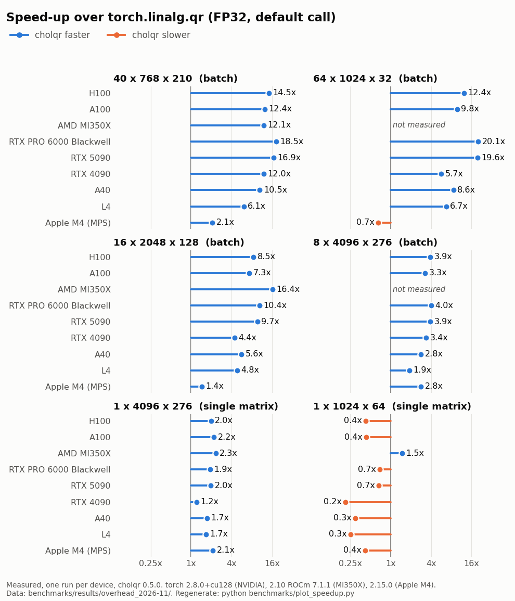

# cholqr



Fast, compile-friendly **shifted CholeskyQR3** for batched tall-skinny matrices in PyTorch. A drop-in for
`torch.linalg.qr(Y)[0]` when you only need an orthonormal basis of `range(Y)`: randomized SVD, low-rank optimizers
such as randomized Muon, PowerSGD, subspace iteration.

CholeskyQR is much faster than Householder QR for GPU batches, but it can lose orthogonality or break down on
ill-conditioned input, especially in FP32. cholqr detects most breakdowns at run time and can certify its output with an
FP64 check (`verify=True`). **Use it** for batches or larger shapes on a GPU; **prefer `torch.linalg.qr`** for a single
small matrix (`method="auto"` picks it for you).

## Install

```bash
pip install cholqr        # or: uv add cholqr
```

Depends only on PyTorch (>= 2.1); install your CUDA or ROCm build first if you need one.

## Usage

```python
import torch
from cholqr import cholesky_qr

Y = torch.randn(40, 768, 210, device="cuda")       # batch of tall-skinny matrices
Q = cholesky_qr(Y)                                 # shifted CholeskyQR3 (default)
Q = cholesky_qr(Y, method="auto")                  # shapes vary: a single small matrix goes to Householder
Q = cholesky_qr(Y, robust=True)                    # FP64 first pass, for cond(Y) up to >= 1e8
Q = cholesky_qr(Y, verify=True)                    # returned only if an FP64 bound certifies orthogonality
```

Three things to know:
- **TF32.** With `set_float32_matmul_precision("high")`, orthogonality can silently degrade to ~1e-3. Use `"highest"`
  around the call, or `verify=True`.
- **`torch.compile`.** The breakdown check is skipped inside a graph; use `robust=True`, or check outside it.
- **DDP / FSDP.** Do not use `on_breakdown="raise"`; make any fallback decision identical on every rank.

More in the [usage guide](https://github.com/createcentury/cholqr/blob/main/docs/usage.md): speed tables, choosing a
method, `torch.compile`, a settings cheat sheet.

## How much to trust this

| level | what | where |
|---|---|---|
| **Proved** (Lean 4) | exact-arithmetic core of the rounding analysis, algebra of the `verify=True` certificate | [lean/](https://github.com/createcentury/cholqr/blob/main/lean/README.md) |
| **Certified at run time** | `verify=True`: FP64 bound on `‖QᵀQ − I‖_F`; rigorous if the note's assumptions (H0)–(H2) hold, (H2) is assumed, not checked | [verify.md](https://github.com/createcentury/cholqr/blob/main/docs/verify.md) |
| **Measured** (pre-registered) | where FP32 `scqr3` breaks, speed-ups, TF32 behaviour | [results](https://github.com/createcentury/cholqr/tree/main/benchmarks/results), [note](https://doi.org/10.5281/zenodo.24182849) |
| **Empirical, not proved** | the run-time detector's threshold and the rule for when an FP32 Cholesky fails | [accuracy.md](https://github.com/createcentury/cholqr/blob/main/docs/accuracy.md) |

There is **no a-priori guarantee** that a given FP32 input will not break down; the
[technical note](https://doi.org/10.5281/zenodo.24182849) explains why. You get detection (empirical) and
certification after the fact (`verify=True`).

## Documentation

[How it works](https://github.com/createcentury/cholqr/blob/main/docs/how-it-works.md) ·
[Usage guide](https://github.com/createcentury/cholqr/blob/main/docs/usage.md) ·
[Accuracy](https://github.com/createcentury/cholqr/blob/main/docs/accuracy.md) ·
[Certified orthogonality](https://github.com/createcentury/cholqr/blob/main/docs/verify.md) ·
[Devices](https://github.com/createcentury/cholqr/blob/main/docs/devices.md) ·
[Compatibility](https://github.com/createcentury/cholqr/blob/main/docs/compatibility.md) ·
[PowerSGD / distributed](https://github.com/createcentury/cholqr/blob/main/docs/powersgd.md)

## Citation

Please cite the software ([CITATION.cff](https://github.com/createcentury/cholqr/blob/main/CITATION.cff)), the technical
note, and the algorithm papers:

> S. Fukuda. *cholqr: fast, compile-friendly shifted CholeskyQR3 for batched tall-skinny matrices in PyTorch.*
> Software, v0.5.1, 2026. doi:[10.5281/zenodo.24157501](https://doi.org/10.5281/zenodo.24157501)
> (all versions: [10.5281/zenodo.24144958](https://doi.org/10.5281/zenodo.24144958))

> S. Fukuda. *Shifted CholeskyQR in FP32: measured breakdown, an a-posteriori bound, and an FP64 orthogonality check in
> cholqr.* Technical note, v1, 2026. doi:[10.5281/zenodo.24182849](https://doi.org/10.5281/zenodo.24182849)

> T. Fukaya, R. Kannan, Y. Nakatsukasa, Y. Yamamoto, Y. Yanagisawa. *Shifted Cholesky QR for computing the QR
> factorization of ill-conditioned matrices.* SIAM J. Sci. Comput. 42(1):A477–A503, 2020.

> Y. Yamamoto, Y. Nakatsukasa, Y. Yanagisawa, T. Fukaya. *Roundoff error analysis of the CholeskyQR2 algorithm.*
> Electron. Trans. Numer. Anal. 44:306–326, 2015.

## License

MIT
