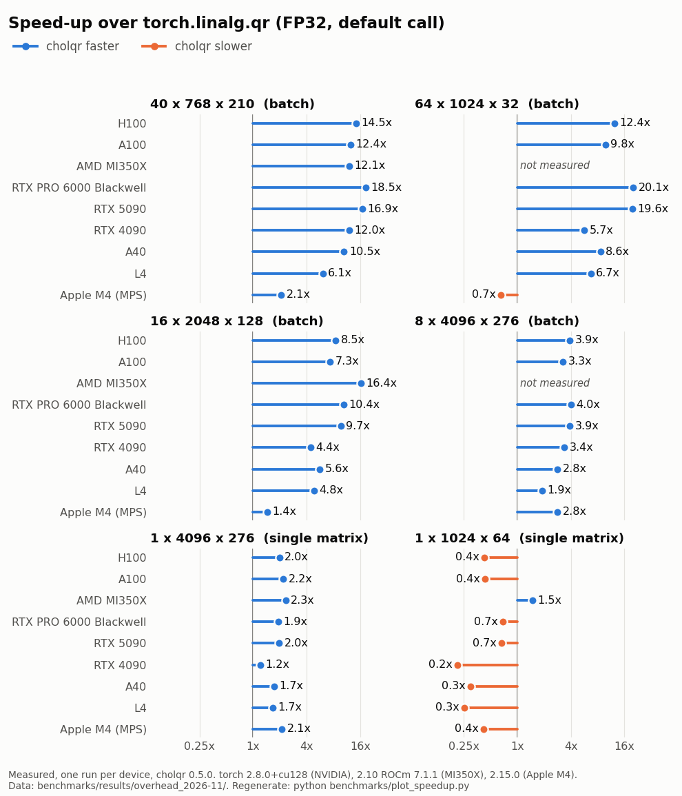

# Usage guide

Details that used to live in the README: speed numbers, method choice, breakdown handling, `torch.compile`, TF32,
and a settings cheat sheet. [Back to README](https://github.com/createcentury/cholqr#readme)

## Speed

**Speed vs `torch.linalg.qr`** (default call, FP32, precision "highest", median of 50 calls, torch 2.8 / CUDA 12.8):

| GPU | batch 40 x 768 x 210 | batch 64 x 1024 x 32 | single 1 x 1024 x 64 |
|---|---|---|---|
| H100 80GB | **14.5x** faster | **12.4x** | 0.43x (slower) |
| RTX 4090 | **12.0x** | **5.7x** | 0.21x |
| RTX 5090 | **16.9x** | **19.6x** | 0.67x |
| RTX PRO 6000 Blackwell | **18.5x** | **20.1x** | 0.69x |

cholqr pays off for batches and larger shapes; for one small matrix `torch.linalg.qr` is faster, and `method="auto"`
dispatches it there automatically. The breakdown check adds 0–7% ([details](https://github.com/createcentury/cholqr/blob/main/docs/devices.md)).



## TF32

> **TF32 warning.** Many training scripts set `torch.set_float32_matmul_precision("high")` (TF32). With plain TF32
> products, CholeskyQR does not fail, but orthogonality silently degrades to ~1e-3 and the breakdown check cannot see
> it. cholqr 0.5 compensates (3xTF32), which removes most but not all of the loss and is slower than full FP32. If you
> need orthogonality below 1e-4, wrap the call in `torch.set_float32_matmul_precision("highest")` or pass `verify=True`
> ([details](https://github.com/createcentury/cholqr/blob/main/docs/accuracy.md)).

## Breakdown detection and fallback

CholeskyQR breaks down when the input is too ill-conditioned for the
chosen method. In eager mode, `cholqr` detects this and recomputes only the affected matrices: first with an FP64 first
pass, then with Householder QR. The check reuses the small r x r Cholesky factors the passes already compute (no extra
Gram product), but costs one host synchronization per call. Choose the behaviour with `on_breakdown`: `"fallback"`
(default), `"warn"`, `"raise"` or `"ignore"` (the 0.4 behaviour, no synchronization). Inside `torch.compile` the check
is skipped. This detector is **empirical** (calibrated and validated, not proved; under TF32 it misses most degraded
runs). For a guarantee use `verify=True` ([Certified orthogonality](https://github.com/createcentury/cholqr/blob/main/docs/verify.md)).
How the threshold was chosen: [Accuracy](https://github.com/createcentury/cholqr/blob/main/docs/accuracy.md).

## Choosing a method, `torch.compile`

| method | passes | reliable range in FP32 (tested) | use when |
|---|---|---|---|
| `"scqr3"` (default) | 3 | cond(Y) ≲ 1e6 | general use |
| `"scqr3"`, `robust=True` | 3 (first in FP64) | cond(Y) up to ≥ 1e8 | ill-conditioned inputs, data-center GPUs |
| `"cqr2"` | 2 | cond(Y) ≲ 1e3 recommended; first breakdown measured from 3e3 (clustered spectra) to 1e4–1e5 (geometric spectra) | known well-conditioned inputs, e.g. sketches without power iteration |
| `"auto"` | — | any | **recommended when shapes vary**: Householder (`torch.linalg.qr`) for a single matrix with r ≤ 64, otherwise `"scqr3"` |
| `"rcqr"` | sketch + 1 | cond(Y) up to ≥ 1e8 (orth ≈ 7e-6) | single large matrices; **slow when batched** (its preconditioner is a batched Householder QR) |

Beyond its range, a method breaks down abruptly. Since 0.5 this is detected and repaired in eager mode (see above),
but every repaired call pays for a second factorization. Pick the method for the conditioning you expect. Under
`torch.compile` there is no check, so use `robust=True` there if the conditioning is unknown, or check outside the graph:

```python
qr = torch.compile(cholesky_qr)                  # in the graph: no check, no fallback, no host sync
Q = qr(Y)
if step % 100 == 0:                              # occasionally, outside the compiled region
    if (cholqr.orthogonality_bound(Q) > 1e-4).any():
        Q = cholesky_qr(Y, verify=True)          # eager: certified, with fallback
```

Measured on an RTX 4090: checking every 100 steps adds about 2% per step (every 10 steps 16-19%, every step
2.6-2.8x, because FP64 is slow on consumer GPUs); no recompilations or graph breaks.

**Example (randomized low-rank Muon on nanoGPT):** the measured cond(Y) is at most 70 without power iteration (h=0), so `"cqr2"` is safe there. With one power iteration (h=1) it reaches 4.5×10⁴, which needs `"scqr3"`.

## Which settings to use

| goal | call | what you get / cost |
|---|---|---|
| default, most uses | `cholesky_qr(Y)` | ~1e-5 orthogonality for cond(Y) ≤ 1e6 (geometric spectra, measured); breakdowns detected and repaired in eager mode |
| speed, inputs known to be well conditioned (cond ≲ 1e3) | `method="cqr2"` | about 1/3 cheaper |
| one small matrix (r ≤ 64) | `method="auto"` | dispatches to `torch.linalg.qr`, which is faster there |
| ill-conditioned inputs | `robust=True` | FP64 first pass; not on Apple MPS |
| a stated orthogonality guarantee | `verify=True` (optionally `tol=`) | Q returned only if an FP64 bound proves ‖QᵀQ − I‖_F ≤ tol; cost +12–29% on an A100, up to +216% on an RTX 4090 (FP64 at 1/64 speed) |
| TF32 enabled globally | `torch.set_float32_matmul_precision("highest")` around the call, or `verify=True` | see the TF32 warning above |
| `torch.compile`, `torch.func`, `torch.jit.trace` | default call inside; `cholqr.orthogonality_bound(Q)` outside | the data-dependent check and fallback cannot run in a graph |
| float16 / bfloat16 / float8 output | `out_dtype=torch.float32`, or give `tol` | |
| no host synchronization at all | `on_breakdown="ignore"` | no check, no repair |
| multi-process training (DDP, FSDP, ZeRO) | not `on_breakdown="raise"`; make any fallback decision collective | see [Distributed training](https://github.com/createcentury/cholqr/blob/main/docs/powersgd.md#distributed-training-keep-decisions-identical-on-every-rank) |
